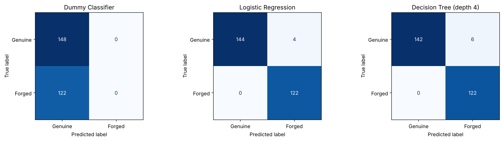
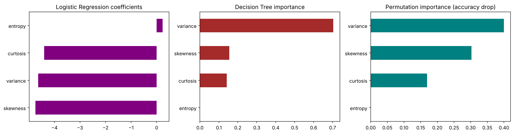

# Beyond Accuracy: A Responsible AI Model Card for Fake Banknote Detection

An educational Data Science project (Project 12 – Model Card) that classifies banknotes as **genuine** or **forged** with Machine Learning and documents the model's performance, errors, limitations and risks in a professional Model Card.

## 1. Project Description
Machine learning models are trained on the UCI Banknote Authentication dataset. The project goes **beyond accuracy**: it studies wrong predictions, feature importance, fairness limits and responsible use.

## 2. Problem Statement
Fake banknotes cause financial losses, and checking notes by hand takes time. Machine Learning can classify banknotes from numerical measurements extracted from their images. This project builds and honestly evaluates such models.

**Research question:** How accurately can Machine Learning identify forged banknotes, and what are the limitations and risks of using this model?

## 3. Objectives
- Understand and explore the banknote dataset.
- Prepare the data without data leakage.
- Build a baseline, a Logistic Regression model and a Decision Tree.
- Compare models with accuracy, precision, recall, F1-score, confusion matrices and cross-validation.
- Investigate incorrect predictions and explain important features.
- Write a Responsible AI Model Card.

## 4. Dataset
- **Name:** UCI Banknote Authentication Dataset – [link](https://archive.ics.uci.edu/dataset/267/banknote+authentication)
- **Size:** 1,372 records, 4 numeric features (variance, skewness, curtosis, entropy), extracted from banknote images using a Wavelet Transform.
- **Target (`class`):** 0 = Genuine, 1 = Forged.
- **Cleaning:** no missing values; 24 exact duplicates (all genuine) removed → 1,348 records (738 genuine, 610 forged).
- A copy of the data is saved at `notebooks/banknote_data.txt`.

## 5. Technologies Used
Python · Google Colab / Jupyter · Pandas · NumPy · Matplotlib · Seaborn · Scikit-learn · Git & GitHub

## 6. Project Workflow
1. Load and understand the data → 2. Check shape, missing values, duplicates → 3. Remove duplicates → 4. Exploratory data analysis (graphs) → 5. Separate X and y → 6. Stratified 80/20 train-test split → 7. Train Dummy, Logistic Regression (scaling pipeline) and Decision Tree → 8. Evaluate on test set → 9. Cross-validation on training data → 10. Error analysis → 11. Feature importance → 12. Limitations, risks and Model Card.

## 7. Machine Learning Algorithms
| Model | Role |
|---|---|
| Dummy Classifier | Baseline (always predicts the most common class) |
| Logistic Regression (+ StandardScaler pipeline) | Main model |
| Decision Tree (max depth 4) | Easy-to-explain comparison model |

## 8. Results
Test set: 270 banknotes (random seed 42). Forged = positive class.

| Model | Accuracy | Precision | Recall | F1-score | CV accuracy (train only) |
|---|---|---|---|---|---|
| Dummy Classifier | 0.5481 | 0.0000 | 0.0000 | 0.0000 | 0.5473 |
| **Logistic Regression** | **0.9852** | 0.9683 | 1.0000 | 0.9839 | **0.9944** |
| Decision Tree (depth 4) | 0.9778 | 0.9531 | 1.0000 | 0.9760 | 0.9545 |

- Logistic Regression made 4 mistakes and the Decision Tree 6 out of 270; all were genuine notes wrongly called forged. No forged note was missed on this test set.
- Variance and skewness were the most important features; entropy had almost no effect.




## 9. Model Card
The full Model Card is in [`reports/model_card.md`](reports/model_card.md). It documents purpose, data, metrics, error analysis, fairness, limitations, risks, inappropriate uses and references.

## 10. Project Folder Structure
```text
Fake-Banknote-Detection-Model-Card/
├── README.md
├── requirements.txt
├── notebooks/
│   ├── fake_banknote_detection.ipynb   # full analysis with outputs
│   └── banknote_data.txt               # copy of the UCI data
├── images/                             # graphs saved by the notebook
├── reports/
    ├── model_card.md
    ├── model_results.csv
    ├── cross_validation_results.csv
    ├── feature_importance.csv
    └── misclassified_test_records.csv


## 11. Installation
```bash
git clone https://github.com/UshaniDhanushika/Fake-Banknote-Detection-Model-Card.git
cd Fake-Banknote-Detection-Model-Card
pip install -r requirements.txt
```

## 12. How to Run
**Google Colab:** open Colab → *File → Upload notebook* → choose `notebooks/fake_banknote_detection.ipynb` → *Runtime → Run all*. The notebook downloads the data from UCI (or uses `banknote_data.txt` if the download fails).

**Locally:** run `jupyter notebook` from inside the `notebooks/` folder, open `fake_banknote_detection.ipynb` and choose *Run All*. The notebook creates `images/` and `reports/` folders next to where it runs; the copies of these outputs that are already in this repository were produced by the same notebook.

## 13. Limitations
- Small, old research dataset; unknown currency; not representative of real-world forgeries.
- Inputs are pre-computed image statistics; other scanners may give different values.
- Small test set (270 notes); a few near-duplicate rows remain.
- No demographic data, so demographic fairness cannot be assessed.

## 14. Responsible AI Statement
This is an **educational model only**. It is **not a certified banknote authentication system** and must **not** be used as the sole basis for any financial or legal decision. False alarms can wrongly accuse honest people and missed forgeries cause financial loss, so a human must review uncertain cases.

## 15. References
1. UCI Banknote Authentication dataset – https://archive.ics.uci.edu/dataset/267/banknote+authentication
2. Mitchell, M. et al. (2019). *Model Cards for Model Reporting*. FAT* '19.
3. Pedregosa, F. et al. (2011). *Scikit-learn: Machine Learning in Python*. JMLR 12, 2825–2830.

## 16. Author
Ushani Dhanushika
