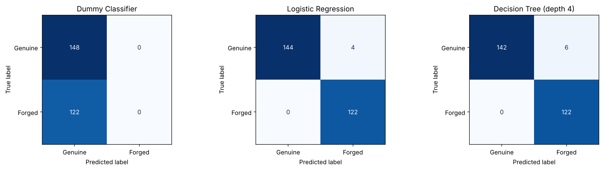

# Model Card: Fake Banknote Detection (Educational)

> **Beyond Accuracy: A Responsible AI Model Card for Fake Banknote Detection**
> All numbers in this card come from the executed notebook `notebooks/fake_banknote_detection.ipynb` (random seed 42). Result tables are saved in `reports/*.csv`.

## 1. Model Name
**Banknote Authenticity Classifier – Logistic Regression (scaled pipeline)**, compared with a Dummy Classifier baseline and a Decision Tree (max depth 4).

## 2. Model Overview
A small machine learning project that predicts whether a banknote is **genuine (0)** or **forged (1)** from four numbers extracted from a banknote image. Three models were trained and compared. The best model was Logistic Regression.

## 3. Intended Purpose
Education and examination: to show how to build, evaluate and honestly document a classification model, including its errors, limits and risks.

## 4. Intended Users
Students, teachers and examiners learning data science and Responsible AI. **Not** intended for banks, shops, police or the public.

## 5. Dataset Source
UCI Machine Learning Repository – *Banknote Authentication* dataset: https://archive.ics.uci.edu/dataset/267/banknote+authentication

## 6. Dataset Description
- 1,372 records, 4 numeric input features, 1 target, no missing values.
- Data were extracted from images of genuine and forged banknote-like specimens, digitised and processed with a Wavelet Transform.
- 24 exact duplicate rows (all genuine) were found and removed, leaving **1,348 records** (738 genuine, 610 forged).
- The dataset does not state the currency or country, the scanner, or the date of collection.

## 7. Features and Target
| Name | Type | Meaning |
|---|---|---|
| variance | number | Variance of the Wavelet-transformed image |
| skewness | number | Skewness of the Wavelet-transformed image |
| curtosis | number | Curtosis of the Wavelet-transformed image |
| entropy | number | Entropy of the image |
| **class (target)** | 0 / 1 | 0 = genuine, 1 = forged |

## 8. Data Preprocessing
1. Loaded the data and named the columns.
2. Checked shape, missing values (none) and duplicates (24).
3. Removed exact duplicate rows to reduce train/test leakage.
4. Split into **80% training (1,078 rows)** and **20% testing (270 rows)** using a stratified split (`random_state=42`).
5. Standardised features with `StandardScaler` **inside a Pipeline**, so scaling is learned from training data only (no data leakage).

## 9. Model Architecture and Algorithms
| Model | Description |
|---|---|
| Dummy Classifier | Always predicts the most frequent class. Baseline only. |
| Logistic Regression | `StandardScaler` → `LogisticRegression(max_iter=1000)`. Main model. |
| Decision Tree | `DecisionTreeClassifier(max_depth=4)`. Easy to explain. |

## 10. Training Methodology
Models were trained only on the training set. No hyper-parameter tuning was done on the test set. The depth limit of 4 was chosen in advance as a simple setting.

## 11. Evaluation Methodology
- Test-set metrics (accuracy, precision, recall, F1-score) with **forged = positive class**.
- Confusion matrices.
- 5-fold stratified cross-validation on the **training data only**.
- Train vs test accuracy comparison (overfitting check).
- Manual error analysis and three feature-importance methods.

## 12. Performance Metrics
**Test set (270 notes: 148 genuine, 122 forged)**

| Model | Accuracy | Precision | Recall | F1-score |
|---|---|---|---|---|
| Dummy Classifier | 0.5481 | 0.0000 | 0.0000 | 0.0000 |
| **Logistic Regression** | **0.9852** | 0.9683 | 1.0000 | 0.9839 |
| Decision Tree (depth 4) | 0.9778 | 0.9531 | 1.0000 | 0.9760 |

**5-fold cross-validation (training data only)**

| Model | Accuracy (mean) | Accuracy (std) | Precision | Recall | F1 |
|---|---|---|---|---|---|
| Dummy Classifier | 0.5473 | 0.0012 | 0.0000 | 0.0000 | 0.0000 |
| Logistic Regression | 0.9944 | 0.0019 | 0.9899 | 0.9980 | 0.9939 |
| Decision Tree (depth 4) | 0.9545 | 0.0115 | 0.9366 | 0.9652 | 0.9504 |

**Overfitting check (train vs test accuracy):** Logistic Regression 0.9944 vs 0.9852; Decision Tree (depth 4) 0.9768 vs 0.9778. No strong overfitting was observed.

## 13. Confusion Matrix
Rows = true class, columns = predicted class (test set).

| Logistic Regression | Predicted Genuine | Predicted Forged |
|---|---|---|
| **Actually Genuine** | 144 | 4 (false positives) |
| **Actually Forged** | 0 (false negatives) | 122 |

| Decision Tree | Predicted Genuine | Predicted Forged |
|---|---|---|
| **Actually Genuine** | 142 | 6 (false positives) |
| **Actually Forged** | 0 (false negatives) | 122 |

## 14. Error Analysis
- Logistic Regression made **4** mistakes and the Decision Tree **6** out of 270 test notes. Because both are fewer than ten, **all** were studied; none were invented.
- **Every mistake was a false positive** (a genuine note called forged). No forged note was missed in this test set.
- Only one test note (row 243: variance 0.38, skewness 0.71, curtosis 0.76, entropy −0.44) was wrong for both models. Its values lie between the typical genuine and forged values.
- Logistic Regression's mistakes had forged-probabilities of only about 0.69–0.76, so the model was not very confident. Low confidence can be used to send a note for human checking.
- Two Logistic Regression errors are the same banknote record stored with different rounding (0.3292 vs 0.32924), i.e. one hard case counted twice.
- Five of the six Decision Tree errors have high curtosis (about 7–9) and negative variance, a region where the shallow tree was not precise.
- Full table: `reports/misclassified_test_records.csv`.

## 15. Feature Importance
| Feature | LogReg coefficient (scaled) | Tree importance | Permutation importance (accuracy drop) |
|---|---|---|---|
| variance | −4.6347 | 0.7031 | 0.3998 |
| skewness | −4.7386 | 0.1547 | 0.3025 |
| curtosis | −4.3971 | 0.1422 | 0.1695 |
| entropy | 0.2355 | 0.0000 | 0.0000 |

Variance, skewness and curtosis matter; **entropy hardly matters**. Importance describes how the *model* behaves; it does not prove cause and effect. See `images/feature_importance.png`.

## 16. Fairness Considerations
The dataset contains **no demographic or personal information** (no gender, age, ethnicity, nationality or location). Therefore **demographic fairness cannot be fully assessed**. A different kind of unfairness is still possible: banknotes from a different currency, printer or scanner than the training data may be misclassified more often, and honest people holding such notes could be wrongly suspected.

## 17. Limitations
1. Small, old research dataset (1,348 rows after cleaning); not representative of all currencies or forgery methods.
2. Inputs are pre-calculated image statistics; real scans from other devices may differ.
3. Very high scores on a clean dataset can overstate real-world performance; forgers adapt.
4. Small test set (270 notes): one mistake changes accuracy by about 0.4 percentage points.
5. About 5 near-duplicate rows (same values, different rounding) remain after exact-duplicate removal; at most one test note has a near-copy in training.
6. Single random split plus cross-validation; no external validation data.

## 18. Potential Risks
| Risk | Effect |
|---|---|
| False positive (genuine called forged) | Honest person or business wrongly accused or refused. All our test errors were this type. |
| False negative (forged called genuine) | Fake money accepted; financial loss. Zero in our test set, but this is not a guarantee. |
| Automation bias | People trust the computer and stop checking. |
| Distribution shift | Performance may drop on new notes or scanners. |
| Misuse | Using an educational model as a real security tool. |

## 19. Ethical Considerations
Wrong accusations can harm people, so a human must review uncertain cases. Results must be reported honestly, including the limits of the data. No personal data was used. The dataset is public and used under its UCI terms.

## 20. Inappropriate Uses
- Real banknote verification at banks, shops, ATMs or borders.
- Any legal, police or financial decision about a person.
- Use on other currencies or on images not processed the same way as this dataset.
- Use as the sole basis for any financial decision.

**This is an educational model. It is not a certified banknote authentication system.**

## 21. Recommendations
- Keep a human in the loop; send low-confidence predictions for manual checking.
- Test on new data from different scanners and currencies before any serious use.
- Treat false positives and false negatives separately and decide which is costlier.
- Collect more and recent data, including hard and borderline cases.
- Re-check with a larger test set and report confidence intervals.

## 22. Conclusion
Logistic Regression was the best model (98.5% test accuracy, recall 1.00, CV accuracy 99.4%) and far better than the 54.8% Dummy baseline. Variance and skewness were the most useful features. However, accuracy alone is not enough: the data are small and clean, all errors were false alarms on genuine notes, and the model must not be used for real authentication.

## 23. References
1. UCI Machine Learning Repository, *Banknote Authentication* dataset. https://archive.ics.uci.edu/dataset/267/banknote+authentication
2. Dua, D. and Graff, C. (2019). *UCI Machine Learning Repository*. University of California, Irvine.
3. Mitchell, M. et al. (2019). *Model Cards for Model Reporting*. Proceedings of the Conference on Fairness, Accountability, and Transparency (FAT* '19).
4. Pedregosa, F. et al. (2011). *Scikit-learn: Machine Learning in Python*. Journal of Machine Learning Research, 12, 2825–2830.
